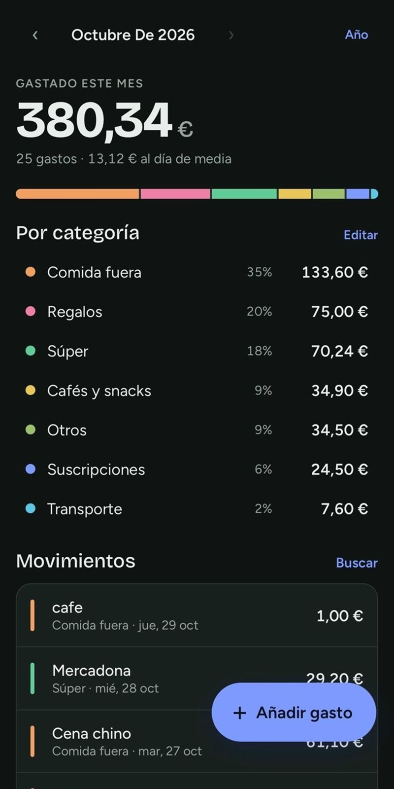
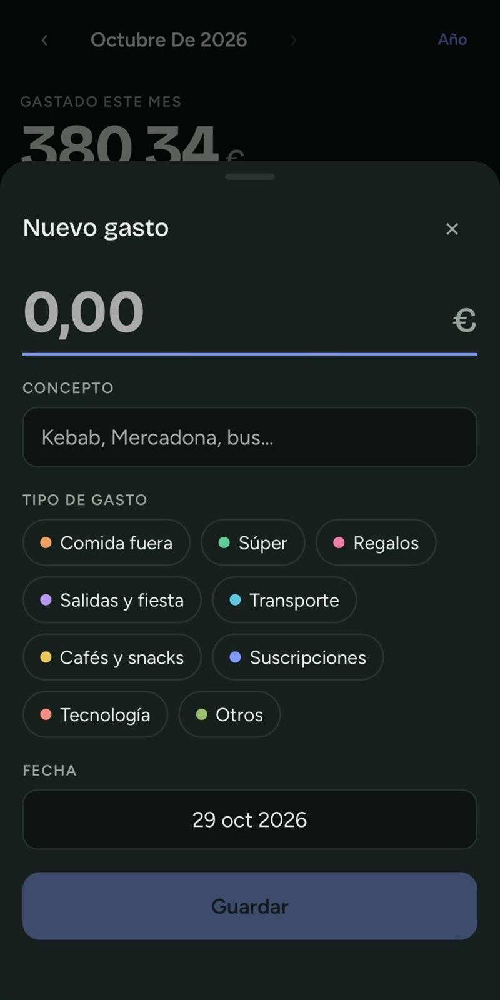

# Mis Gastos

> Apunta tus gastos en segundos. Sin suscripciones, sin rastreos, sin complicaciones.

<p align="center">
  
  &nbsp;&nbsp;
  
</p>

---

## Características

- **Ingresos y gastos** — balance del mes, con y sin gastos extraordinarios
- **Gastos e ingresos fijos** — marca «Cada mes» y se apuntan solos cada mes (se quitan en Ajustes)
- **Extraordinarios** — compras puntuales que no cuentan en la media diaria
- **Teclado propio y categoría sugerida** — apuntar un gasto son tres toques
- **Gráfico diario y mensual** — en qué días (o meses) se va el dinero
- **Offline-first** — funciona sin conexión, sincroniza cuando hay red
- **Instantáneo** — carga desde el móvil sin esperar a internet
- **Sincronización en la nube** — opcional con Google, tus datos siempre a salvo
- **Sin registro obligatorio** — úsala sin cuenta, sincroniza cuando quieras
- **PWA instalable** — ponla en la pantalla de inicio como una app nativa
- **Modo oscuro** — automático o elegido en Ajustes
- **Búsqueda inteligente** — ignora tildes y mayúsculas
- **Resumen mensual y anual** — ve en qué te gastas el dinero
- **Exportar a CSV / JSON** — llévate tus datos donde quieras

---

## Instalación en el móvil

### iPhone (iOS)
1. Abre la app en **Safari**
2. Pulsa el botón compartir ↑
3. **Añadir a pantalla de inicio**

### Android
1. Abre la app en **Chrome**
2. Tres puntos ⋮ → **Añadir a pantalla de inicio**

---

## Sincronización con Google (opcional)

Los datos se guardan siempre en tu móvil. Si quieres tenerlos en la nube:

1. Pulsa **Sincronizar con Google** en la parte inferior
2. Elige tu cuenta de Google
3. Listo — tus gastos se sincronizan automáticamente

> Los gastos añadidos sin conexión se suben solos al reconectar.

---

## Publicar tu propia versión

1. Haz fork de este repositorio
2. Ve a **Settings → Pages → Branch: main → Save**
3. En unos minutos estará en `https://TU-USUARIO.github.io/Mis-Gastos/mis-gastos/`

---

## Desarrollo local

```bash
cd mis-gastos
python -m http.server 8000
# Abre http://localhost:8000/mis-gastos/
```

---

## Tests

Abre `test.html` en el navegador (con el servidor local de arriba: `http://localhost:8000/test.html`).
Prueba las funciones de `utils.js` y la app completa con un Firebase simulado: añadir, editar y borrar,
ingresos, extraordinarios, fijos, teclado, categorías, búsqueda, resumen del año, copias, sesión y sin conexión.

---

## Estructura

```
mis-gastos/
├── index.html       # Estructura de la app
├── app.js           # Pantalla: gastos, ingresos, fijos, categorías, sync, auth
├── utils.js         # Funciones puras (las prueba test.html)
├── icons.js         # Iconos (Lucide, licencia ISC)
├── style.css        # Diseño y temas claro/oscuro
├── firestore.rules  # Reglas de Firestore (cópialas en la consola de Firebase)
├── sw.js            # Service Worker (offline + caché)
├── manifest.json    # Configuración PWA
├── fonts/           # Fuente autoalojada (Geist, licencia OFL)
├── icon-*.png/.svg  # Iconos de la app (logo.svg es el original editable)
└── test.html        # Tests de funciones puras
```

---

## Personalización

**Categorías:** edita `DEFAULT_CATS` (gastos) o `INCOME_CATS` (ingresos) en `utils.js`. Cada una lleva un color (`--c0`…`--c10` en `style.css`).

**Después de cambiar archivos:** sube la versión del caché en `sw.js` para que los móviles cojan los cambios.
